# Campus Events

A smart campus event management system. Students and faculty create, discover and register for university events. Admins see reports. FastAPI, PostgreSQL and React.

The idea at the centre: a small, reusable **CRUD framework** for REST (backend and frontend). Users, events and registrations are built on top of it. A new resource takes about 20 lines, not a new set of hand written routes.

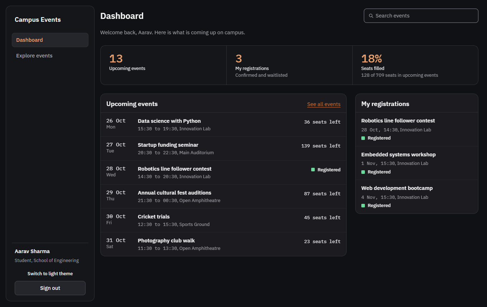

## Contents

1. [Quick start](#quick-start)
2. [Configuration](#configuration)
3. [Architecture](#architecture)
4. [Data model](#data-model)
5. [Roles and rules](#roles-and-rules)
6. [API summary](#api-summary)
7. [The query convention](#the-query-convention)
8. [Add a new resource in 20 lines](#add-a-new-resource-in-20-lines)
9. [AI features and fallbacks](#ai-features-and-fallbacks)
10. [Design system](#design-system)
11. [Tests and checks](#tests-and-checks)
12. [Five minute demo script](#five-minute-demo-script)
13. [Decisions](#decisions)
14. [Known gaps](#known-gaps)

## Quick start

You need Docker, Python 3.12 or newer, and Node 18 or newer. On Windows use `.venv/Scripts/python`, on Linux and macOS use `.venv/bin/python`.

```
cp .env.example .env
docker compose up -d db
cd backend && python -m venv .venv && .venv/Scripts/python -m pip install -e ".[dev]"
.venv/Scripts/python -m alembic upgrade head && .venv/Scripts/python -m app.seed
.venv/Scripts/python -m uvicorn app.main:app --port 8000
cd ../frontend && npm install && npm run dev
```

Open <http://localhost:5173>. The API and its generated documentation are at <http://localhost:8000/docs>.

The seed prints the demo logins. Each sign in page also has Admin, Faculty and Student buttons that fill the form.

| Role | Email | Password |
|---|---|---|
| Admin | `admin@campus-demo.test` | `admin123` |
| Faculty | `faculty1@campus-demo.test` to `faculty4@campus-demo.test` | `faculty123` |
| Student | `aarav.sharma@campus-demo.test` and 39 others | `student123` |

## Configuration

One `.env` file in the repo root configures both sides. Vite reads only the `VITE_` values.

| Variable | What it does |
|---|---|
| `POSTGRES_USER`, `POSTGRES_PASSWORD`, `POSTGRES_DB`, `POSTGRES_PORT` | The Docker database. The host port is **5433**, so it does not clash with a local PostgreSQL on 5432. |
| `DATABASE_URL` | The app database. |
| `TEST_DATABASE_URL` | The test database. It must end in `_test`, and the tests refuse to run otherwise. Docker creates it on first start. |
| `JWT_SECRET`, `JWT_EXPIRE_MINUTES` | Token signing. Change the secret outside a demo. |
| `FRONTEND_ORIGIN` | The only origin allowed by CORS. |
| `GEMINI_API_KEY` | Google AI Studio key. Leave it empty and every AI feature runs on its fallback. |
| `GEMINI_MODEL` | Default `gemini-3.5-flash-lite`. See [AI features](#ai-features-and-fallbacks). |
| `VITE_API_URL` | Where the frontend finds the API. |
| `VITE_INSTITUTION_NAME` | The name shown in the app. Default "Campus Events". |
| `VITE_INSTITUTION_LOGO` | Optional logo URL for the logo slot. No real university branding ships with the app. |
| `VITE_DEMO_LOGINS` | Set to `false` to hide the demo account buttons. |

## Architecture

Three layers. The framework knows nothing about events or users. Resources describe themselves to the framework. Domain routers hold the rules that do not fit a plain CRUD route.

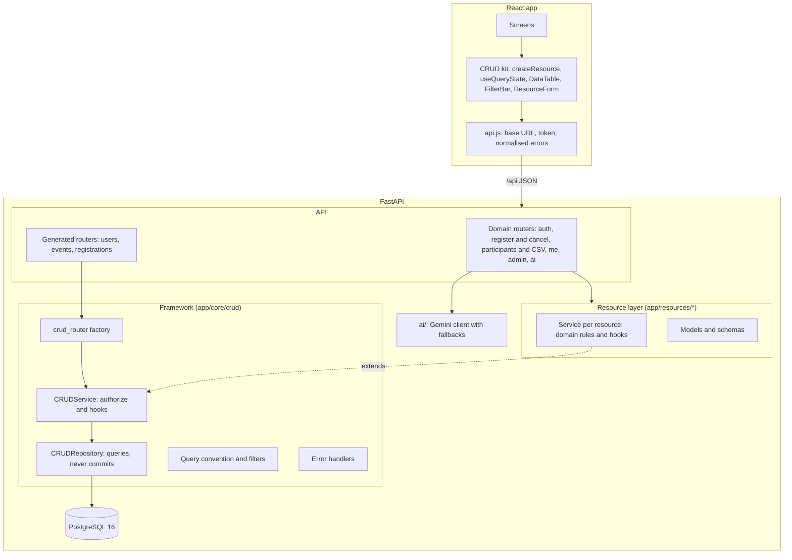

```
backend/app/core/crud/     generic framework: repository, service, router factory, query, errors, permissions
backend/app/resources/     users, events, registrations: models, schemas, service, router each
backend/app/domain/        auth, event_registration, me, admin, ai
backend/app/ai/            one client module, then search, draft, recommend, summary
backend/alembic/           migrations (tables are never created outside tests)
frontend/src/lib/crud/     api.js, createResource, useQueryState, DataTable, FilterBar, ResourceForm
frontend/src/components/   own Button, Input, Select, Dialog, Tabs, Toast, charts, icons
frontend/src/styles/       tokens.css, glass.css (the surface classes), base.css
```

Two rules keep the data safe:

- **Repositories and services never commit.** The router commits once a unit of work is complete, so a request that fails halfway rolls back as a whole.
- **Registering locks the event row** (`SELECT ... FOR UPDATE`) and the user row, inside one transaction. Two people taking the last seat are handled one after the other, and one person cannot confirm two overlapping events at once. The tests run 10 simultaneous registrations for one seat and always get exactly one.

## Data model

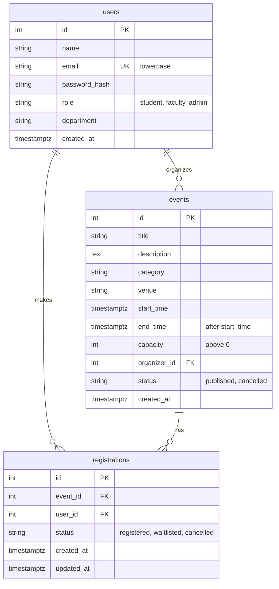

`registrations` has a unique constraint on (event_id, user_id). Indexes: `events.start_time`, `events.category`, `events.organizer_id`, `registrations (event_id, status)` and `registrations.user_id`. Role and status columns are `VARCHAR` with `CHECK` constraints, which keeps migrations simple.

## Roles and rules

| Role | Can do |
|---|---|
| student | Browse, search, register, cancel, see their own registrations |
| faculty | Everything a student can, plus create events, and edit, delete or view participants of their own events |
| admin | Everything, plus manage any event, change user roles, and view reports |

- Public sign up creates only `student` or `faculty`. Only an admin changes a role, through `PATCH /api/admin/users/{id}/role`. Nobody can change their own role through the profile routes, and an admin cannot remove their own admin role.
- A person registers for an event once (a unique constraint plus a plain message).
- When an event is full, new registrations are **waitlisted**. When someone cancels, the oldest waitlisted person is promoted. When an organizer raises capacity, waitlisted people move into the new seats.
- Capacity cannot be lowered below the number of confirmed registrations.
- Nobody can register for an event that has ended or been cancelled.
- A person cannot hold two **confirmed** registrations whose times overlap, and the message names the clashing event. Waitlisted registrations are ignored by that check. If a waitlisted person is promoted into an overlap, the promotion stays and both events show a notice.

## API summary

Everything is under `/api` and returns JSON. The full, always current list is at `/docs`, and `postman/campus-events.json` has every request (run **Auth > POST /auth/login** first, it stores the token).

| Area | Routes |
|---|---|
| Generated | `/users`, `/events`, `/registrations`: list, read, create, update (`PUT` and `PATCH`), delete |
| Auth | `POST /auth/register`, `POST /auth/login` (limited to 10 failed attempts a minute), `GET /auth/me` |
| Events | `GET /events/categories`, `POST` and `DELETE /events/{id}/register`, `GET /events/{id}/participants` and `/participants.csv` |
| Me | `GET /me/registrations`, `GET /me/events` |
| Admin | `GET /admin/stats`, `PATCH /admin/users/{id}/role` |
| AI | `POST /ai/search`, `POST /ai/draft-event`, `GET /ai/recommendations`, `GET /admin/ai/summary` |

Every error has one shape. `fields` appears only for validation and constraint errors:

```json
{ "error": "Email already in use", "fields": { "email": "Already in use" } }
```

Unique, foreign key, not null and check violations are mapped to this shape automatically. Status codes used: 200, 201, 204, 400, 401, 403, 404, 405 (disabled actions), 409, 422, 429.

## The query convention

Every list endpoint, generated or hand written, takes the same parameters and returns the same envelope.

| Parameter | Meaning |
|---|---|
| `page`, `limit` | Pagination. `limit` is capped by the resource's `max_limit`. |
| `sort` | `sort=start_time` or `sort=-start_time`. Only whitelisted fields. |
| `q` | Case insensitive search across the resource's `search_fields`. `%` and `_` are treated as plain characters. |
| `field=value` | Exact filter. |
| `field__gte`, `field__lte` | Range filter. |
| `field__in=a,b` | Set filter. |
| custom | A filter backed by a function, for example `organizer` (an id or part of a name) and `upcoming` on events. |

Filters are declared on the resource, never taken blindly from the request. An unknown filter or sort field returns `400` with the allowed names. The envelope is `{"items": [...], "page": 1, "limit": 12, "total": 134, "pages": 12}`.

The AI search output uses exactly these parameters, so the model's answer feeds straight into `GET /events`.

## Add a new resource in 20 lines

A `venues` resource with a model, schemas, a service and a router. The resource code below is about 20 lines. A migration and one `include_router` line are the only other steps. This exact code runs in `backend/tests/core/test_add_resource_example.py`.

```python
# app/resources/venues.py
from pydantic import BaseModel, ConfigDict, Field
from sqlalchemy import String
from sqlalchemy.orm import Mapped, mapped_column
from app.core.crud import CRUDConfig, CRUDService, Exact, Perm, Range, crud_router
from app.db import Base
from app.deps import get_current_user

class Venue(Base):
    __tablename__ = "venues"
    id: Mapped[int] = mapped_column(primary_key=True)
    name: Mapped[str] = mapped_column(String(80), unique=True)
    capacity: Mapped[int]

class VenueIn(BaseModel):
    name: str = Field(min_length=1, max_length=80)
    capacity: int = Field(gt=0)

class VenueRead(VenueIn):
    model_config = ConfigDict(from_attributes=True)
    id: int

class VenueUpdate(BaseModel):
    name: str | None = Field(default=None, min_length=1, max_length=80)
    capacity: int | None = Field(default=None, gt=0)

class VenueService(CRUDService[Venue, VenueIn, VenueUpdate]):
    model = Venue

router = crud_router(CRUDConfig(
    prefix="/venues", tags=["Venues"], model=Venue, read_schema=VenueRead,
    create_schema=VenueIn, update_schema=VenueUpdate, service=VenueService, current_user=get_current_user,
    permissions={"list": Perm(), "read": Perm(), "create": Perm(roles=("admin",)),
                 "update": Perm(roles=("admin",)), "delete": Perm(roles=("admin",))},
    filters=[Exact("name"), Range("capacity")], search_fields=["name"],
    sortable_fields=["name", "capacity"], default_sort="name",
))
```

Then add `from app.models import ...` for the new model so Alembic sees it, run `alembic revision --autogenerate -m "venues"` and `alembic upgrade head`, and add `api.include_router(venues.router)` in `app/main.py`.

It appears in `/docs` at once with list, read, create, update and delete, and with `page`, `limit`, `sort`, `q`, `name`, `capacity__gte` and `capacity__lte` as documented query parameters. For example `GET /api/venues/?capacity__lte=100&sort=-capacity&q=lab` works with no extra code.

Hooks (`before_create`, `after_create`, `before_update`, `after_update`, `before_delete`, `after_delete`) and `authorize` can be overridden on the service for domain rules. The events service uses them for the capacity rule and for promoting the waitlist. A disabled action (`disabled_actions=("create",)`) returns `405`.

The frontend side is one line: `export const venues = createResource("venues", { singular: "venue" })` gives `list`, `get`, `create`, `update`, `remove` and the hooks `useList`, `useOne`, `useCreate`, `useUpdate`, `useRemove`, with cache keys, invalidation and toasts handled.

## AI features and fallbacks

Model: Google AI Studio (Gemini) through the `google-genai` package, name from `GEMINI_MODEL`. Only `backend/app/ai/client.py` imports the SDK.

Every feature:

- returns JSON that is **validated with Pydantic**, never raw model text,
- has a **deterministic fallback** for a missing key, an error, a timeout (5 seconds) or an answer that fails validation,
- reports `"source": "ai"` or `"source": "fallback"`, and the screen shows which one it was,
- never sends emails, passwords or password hashes to the model.

| Feature | Endpoint | What the model does | Fallback |
|---|---|---|---|
| Natural language search | `POST /ai/search` | Turns "robotics workshops next week" into `q`, `category`, `start_time__gte`, `start_time__lte`. Gets today's date and the real categories. Categories that do not exist are dropped. | The most distinctive word becomes `q`, and a category word such as "workshops" sets the category. |
| Event draft | `POST /ai/draft-event` | Writes a title, a 2 to 3 sentence description and a category from rough notes. Saves nothing. | Notes become the description, the title stays empty. |
| Recommendations | `GET /ai/recommendations` | Ranks real upcoming events (ids must be in the candidate list) with a one line reason. Gets the person's past event titles and department only. | Most popular upcoming events, in categories the person already joined first. |
| Admin summary | `GET /admin/ai/summary` | Writes 4 to 5 sentences from the stats. Rejected if any number is not in the stats data. | A templated summary from the same numbers. |

Notes from building it:

- The default model is `gemini-3.5-flash-lite`. `gemini-2.5-flash` is no longer available to new keys, and the larger Flash models often returned "high demand" during development.
- The API refuses a request deadline under 10 seconds, and a stalled connection ignored the SDK timeout. So the 5 second limit is enforced in our code: the call runs in a worker thread and we stop waiting after 5 seconds. At most 4 calls run at once, and any further request goes straight to the fallback.
- AI endpoints are limited to 30 requests a minute per person.
- Tests mock the SDK for success, errors, timeouts, bad JSON and invalid answers. No test calls the real API.

## Design system

Graphite surfaces with an orange accent, in a **dark theme** (the default) and a **light theme**. The theme follows the system setting until someone picks one with the **Switch to light theme** button (in the sidebar and on the sign in page), and the choice is remembered. All values live in `frontend/src/styles/tokens.css`, and components use only those tokens.

| Role | Token | Dark | Light |
|---|---|---|---|
| Page background | `--base` | `#101114` | `#F7F7FA` |
| Sidebar, filter bars, the figures strip | `--sidebar` | `#15161A` | `#FFFFFF` |
| Cards and panels (tables, forms, lists, event detail) | `--panel` | `#1B1B20` | `#FFFFFF` |
| Raised items (toasts, selected tab, secondary buttons) | `--panel-raised` | `#25262C` | `#EEEEF3` |
| Primary text | `--text` | `#F4F4F5` | `#18181B` |
| Secondary text | `--text-muted` | `#A1A1AA` | `#52525B` |
| Borders and dividers | `--hairline` | `#303139` | `#E1E1E8` |
| Primary accent: links, buttons, focus ring | `--accent` | `#D97736` | `#A94716` |
| Accent hover | `--accent-hover` | `#E9A06F` | `#87380F` |
| Accent pressed | `--accent-pressed` | `#B85D26` | `#702D0C` |
| Subtle accent background (active menu item, chart tracks) | `--accent-subtle` | `#38251B` | `#FBE8DC` |
| Highlight: key figures, the active menu item, the busiest day | `--highlight` | `#E9A06F` | `#87380F` |
| Registered | `--ok` | `#6BD99B` | `#1D7A49` |
| Full, cancelled, destructive | `--warning` | `#F28B82` | `#B42318` |
| Form fields | `--input-fill`, `--input-border` | `#131418`, `#8A8B96` | `#F7F7FA`, `#6B6B78` |

The values for background, cards, text, borders and the four accent colours are the specified palette. The rest (secondary text, sidebar, raised surfaces, status colours, field colours) were chosen to fit it and are held to the same contrast rules. The status colours are deliberately red and green, so they never look like the orange accent.

Spacing uses 4, 8, 12, 16, 24, 32, 48 and 64. Radius is 8 for controls, 14 for panels and 18 for dialogs. Type is IBM Plex Sans for the interface and IBM Plex Mono for dates and numbers, self hosted, at 13, 15, 18, 24 and 32 px. Motion is limited to short colour and opacity changes, and respects `prefers-reduced-motion`.

Status is always a text label plus a small marker whose **shape** also differs, never colour alone: a filled green square for registered, a hollow orange square for waitlisted, a red label for full and cancelled, a hollow circle for ended.

Contrast is checked by a test that reads the real CSS tokens and tests every text and surface pair in **both themes**, including hovered rows, form fields and the button pressed state (`frontend/src/test/contrast.test.js`). The audit script also runs axe's own colour contrast check on every screen in both themes.

Earlier versions: the first design used translucent glass panels over a blurred backdrop (git tag `glass-design`), and the second used dark green solid surfaces with mint and gold. The CSS classes `glass-1`, `glass-2` and `glass-3` kept their names but now paint flat surfaces.

| Screen | Dark | Light |
|---|---|---|
| Sign in | 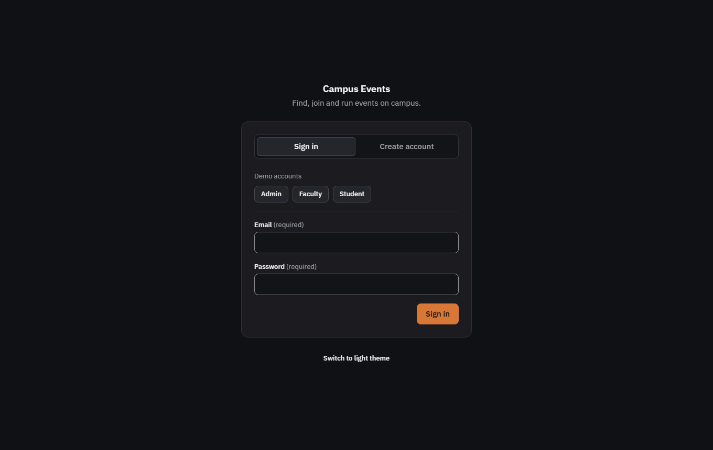 | 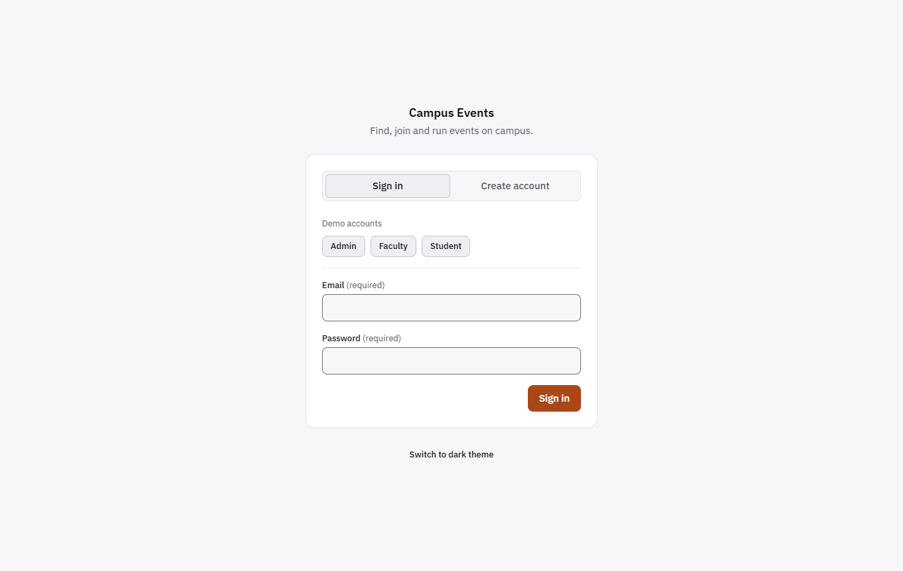 |
| Dashboard (student) |  | 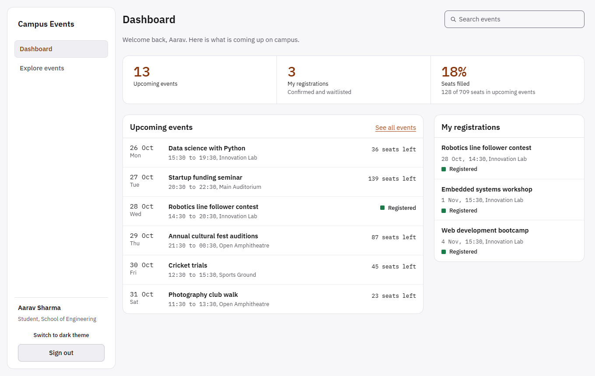 |
| Dashboard (faculty) | 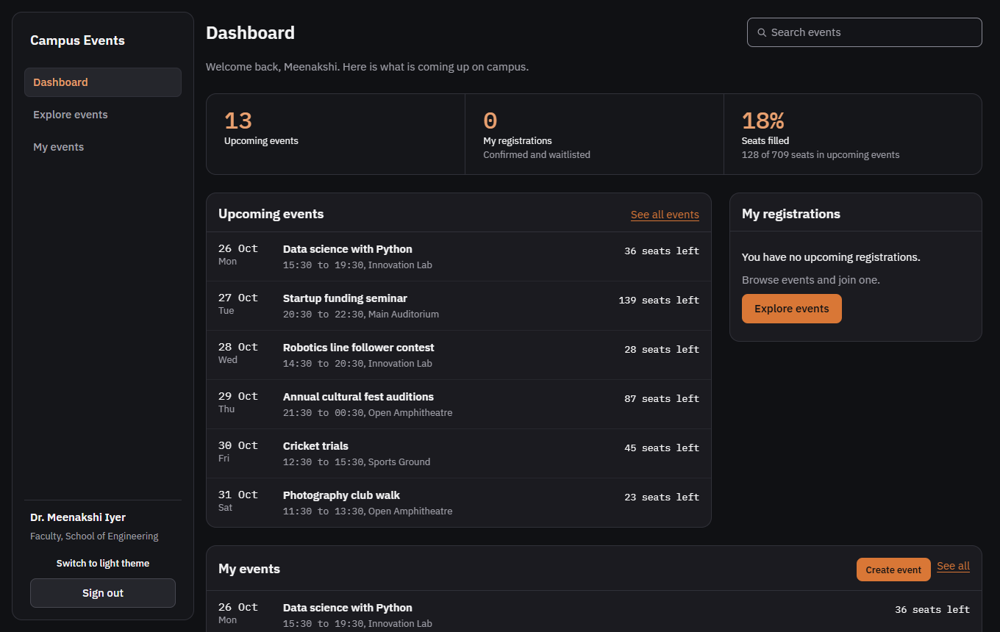 | 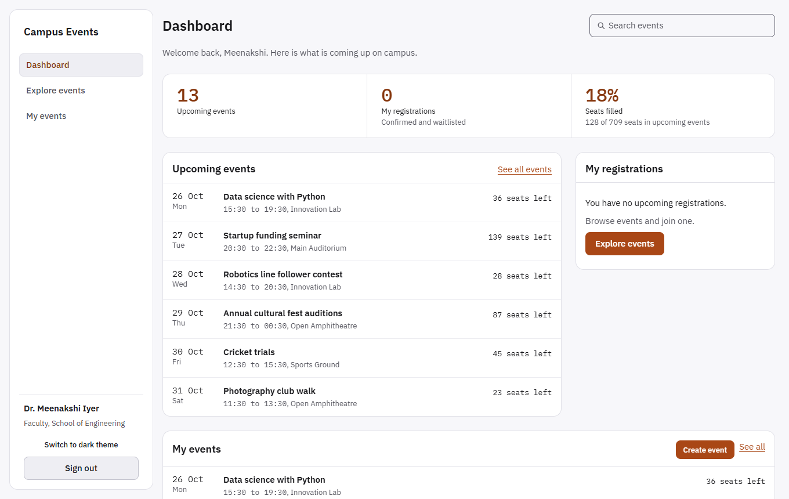 |
| Explore events | 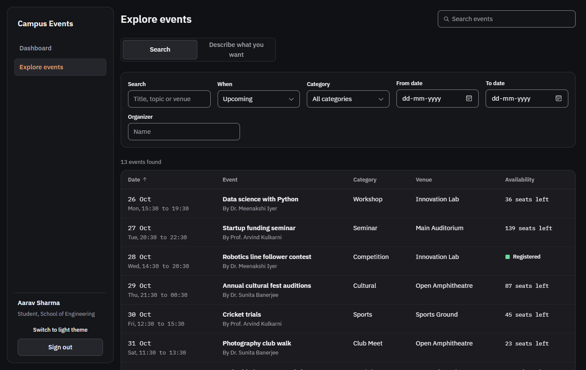 | 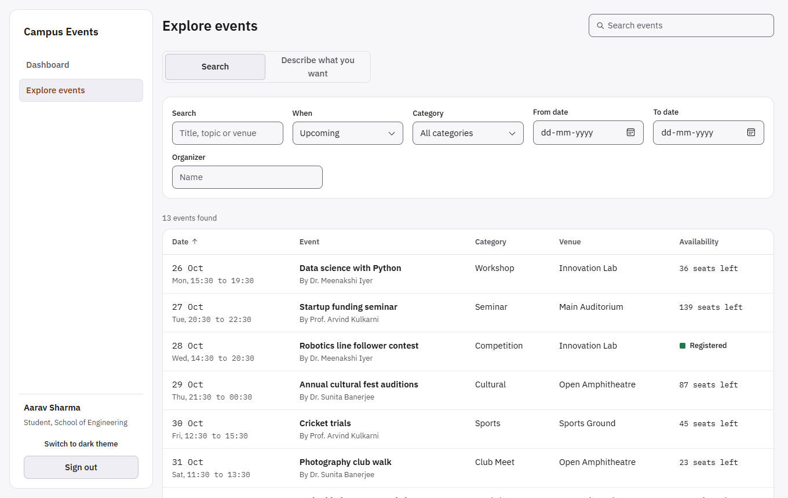 |
| Event detail | 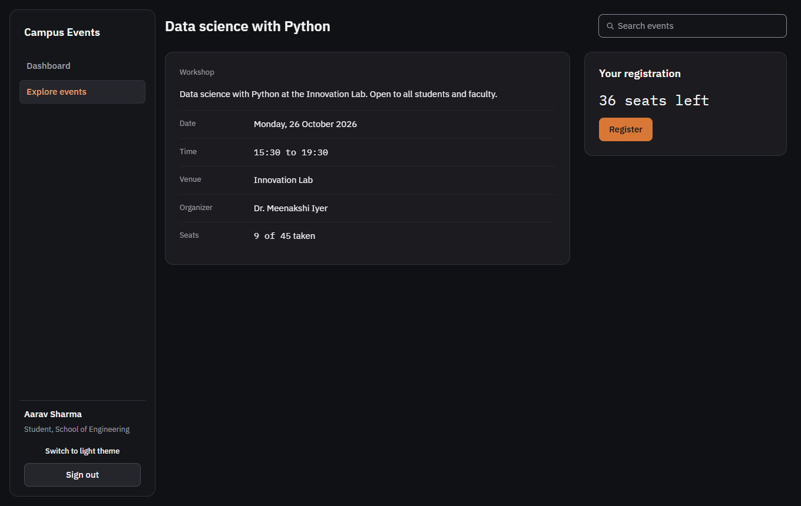 | 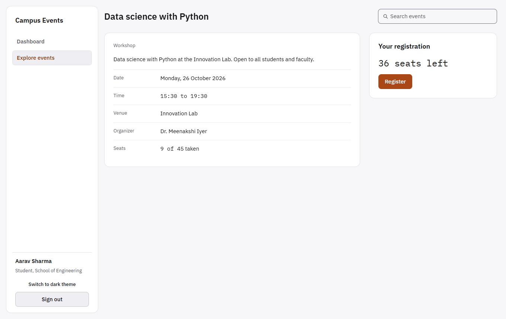 |
| Reports | 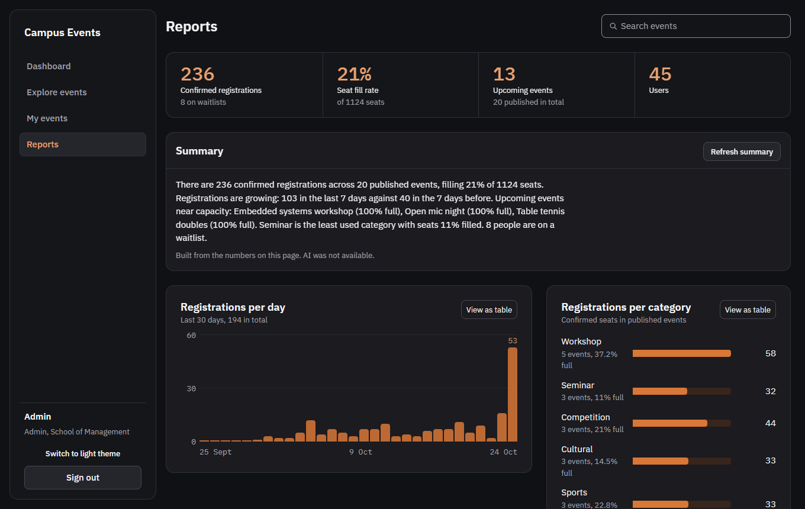 | 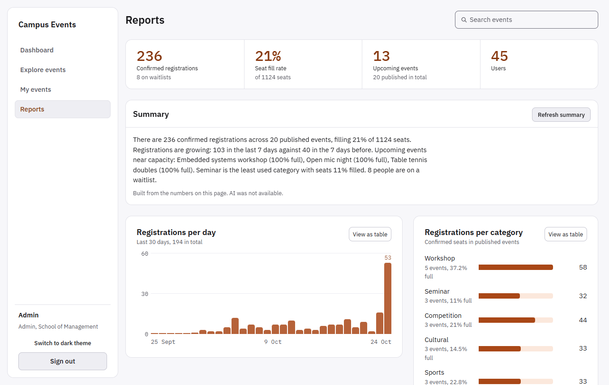 |
| Phone | 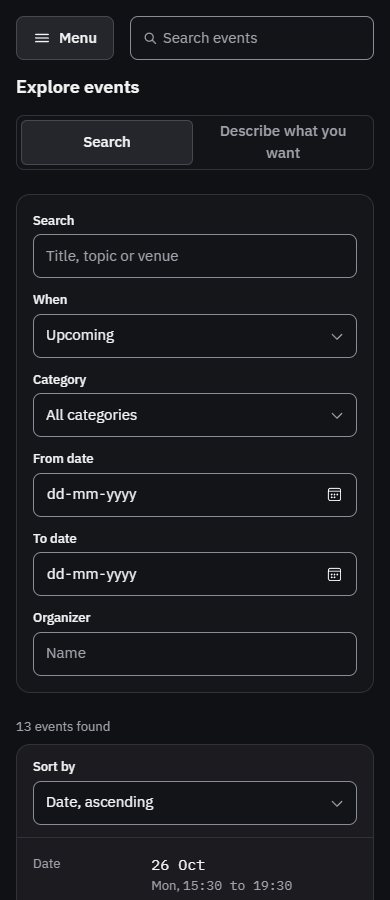 | |

## Tests and checks

```
cd backend && .venv/Scripts/python -m pytest          # API, framework, AI, concurrency
cd frontend && npm test                               # components, CRUD kit, screens, contrast
cd frontend && node scripts/e2e-smoke.mjs             # the whole flow in a real browser (needs both servers running)
cd frontend && node scripts/audit.mjs                 # responsive and axe accessibility audit of every screen
cd frontend && npm run screenshots                    # regenerates docs/screenshots
cd backend && .venv/Scripts/python scripts/make_postman.py   # regenerates the Postman collection
```

- **Backend:** the framework is tested on a dummy model and resource, not the real ones, to show it is reusable: all five actions, pagination bounds, the sort whitelist, each filter type, a custom filter, search, the permission matrix (role plus ownership), hook order, `405` for disabled actions and error mapping. The rest covers auth and role guards, event permissions, duplicate registration, capacity and waitlist promotion, the time clash rule, concurrent last seat registration, stats, and every AI feature on its success and fallback paths.
- **Frontend:** sign in, register, a full list, create, edit, delete cycle through `createResource`, `DataTable` and `ResourceForm`, the event detail states, the AI draft and AI search, role based navigation, the contrast check, and the API wrapper.
- **Browser flow:** `e2e-smoke.mjs` walks login, dashboard, explore, register and cancel, AI search, create with an AI draft, waitlist, promotion, CSV download, delete, reports, a role change, and the 403 and 404 pages.

## Five minute demo script

Start both servers first (see [Quick start](#quick-start)). Use the demo buttons on the sign in page.

**1. Login and dashboard (45 s).** Click **Student**, then **Sign in**. The dashboard shows a strip of figures (upcoming events, my registrations, seats filled), upcoming events on the left and "My registrations" on the right. Point out that the layout is two columns and the figures are plain, not cards.

**2. Explore and AI search (60 s).** Open **Explore events**. Sort by Category, filter by a category, and note the URL changes, so the view can be shared. Switch to **Describe what you want**, type `robotics workshops next week`, press **Find events**. The filters fill in, and the note says whether the AI or the keyword fallback produced them.

**3. Register (45 s).** Open **Data science with Python** and press **Register**. The panel changes to **Cancel registration**. Open **Embedded systems workshop**: it is full, so the button reads **Join waitlist** and you get a queue position. Open an event that overlaps one you hold and show the clash message that names it.

**4. Create an event with AI (60 s).** Sign out, click **Faculty**, open **My events**, press **Create event**. In **Draft with AI** write `intro to drone building, saturday morning, innovation lab, beginners welcome` and press the button. Edit the draft, set a time, make the end earlier than the start to show the inline error, fix it, and save. Nothing is saved until you press the save button.

**5. Manage participants (45 s).** Open the event, press **Manage participants**. Search within participants, then press **Export CSV**. Open **Embedded systems workshop** (it has a waitlist), raise its capacity in **Edit event**, and return to the list: the oldest waitlisted people are now confirmed.

**6. Reports (45 s).** Sign out, click **Admin**, open **Reports**. Show the figures, the AI summary with its source label, registrations per day (hover a bar, or press **View as table**), registrations per category, and top events. In the user table change a role with the selector, and show that your own role selector is disabled.

**7. Access rules (20 s).** Sign in as **Student** and open `/reports`: a clear 403 page. Open `/events/999999`: a clear 404 page.

## Decisions

- PostgreSQL 16 runs only through Docker Compose, with a named volume. The host port is 5433.
- The repository is at github.com/lavan6264/campus-events. Commits are small and use `feat:`, `fix:`, `test:` and `docs:` prefixes. There are no CI workflows.
- Python: the code targets 3.12 or newer. It was developed and tested on 3.13.
- Only `registered` registrations block a time clash. A waitlist spot never does. The clash check applies when a seat would be confirmed, so a person can still join the waitlist of a full event that overlaps something they hold.
- `PUT` and `PATCH` behave the same on generated routes: both change only the fields sent.
- Re-registering after a cancellation goes to the back of the waitlist.
- Only failed sign in attempts count toward the login limit, so a class signing in from one address is never locked out. The limiter is in memory, which is enough for one process.
- Charts are plain HTML and CSS, not a library, so text stays real and readable on a phone. Each can be read as a table.
- The interface uses solid graphite surfaces with an orange accent, in a dark and a light theme. The earlier translucent glass version is kept as the git tag `glass-design`. The CSS classes `glass-1`, `glass-2` and `glass-3` keep their names but now paint flat surfaces.
- Light mode uses pure white for cards, as specified in the palette.
- Email addresses are checked with a plain format rule, not the `email-validator` package, because that package rejects the `.test` domain used by the demo accounts.
- `python -m app.seed` wipes users, events and registrations before recreating them. Dates are relative to the day it runs.
- Fonts come from the `@fontsource` packages, so the build makes no external requests.
- The top bar search has a hidden label and a visible placeholder, because a slim bar has no room for a label above. Every other field has a visible label.
- Signing out does not remember the last page for the next person. An expired session does, so the person returns where they were.

## Known gaps

- The accessibility audit (`scripts/audit.mjs`) found four problems on its first run (no way to sort on phones, small touch targets in rows, tab panels that did not exist, a login page without a heading). They are fixed, and the audit now reports no horizontal scroll, no small touch targets and no axe violations across 12 screens, 3 widths and both themes, including axe's own colour contrast check.
- Events have no price, image or recurrence, and there is no email sending. The brief did not ask for them.
